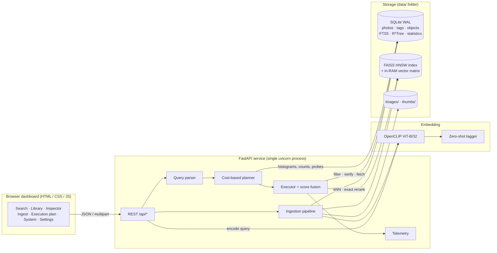
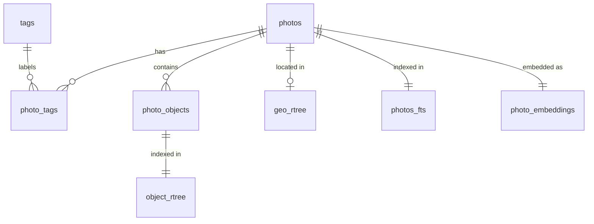
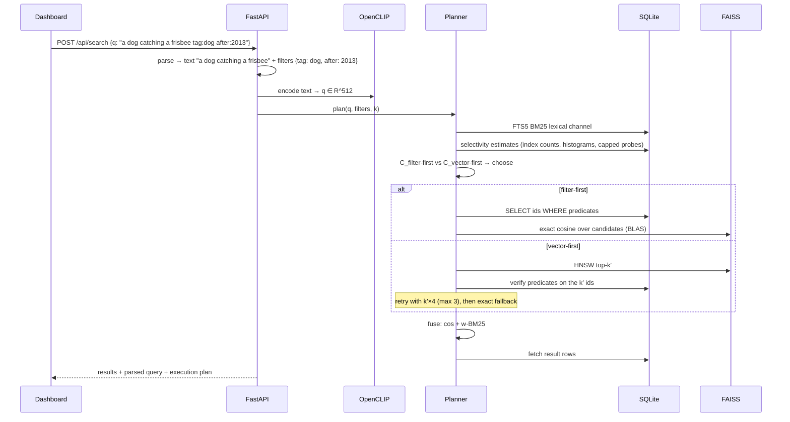

# Hybrid Photo Library Search Engine

> **A photo application on the surface, an intelligent retrieval engine underneath.**
>
> Search a photo library by *describing* what you want ("a dog catching a frisbee on a beach")
> **and** by exact facts ("tagged dog, taken after 2013, within 40 km of London").
> A database-style **cost-based query optimizer** decides, for every query, the fastest
> way to combine the two, and the UI shows you exactly how it did it.


---

## Table of contents

1. [What this project is](#1-what-this-project-is)
2. [The problem it solves](#2-the-problem-it-solves)
3. [Key features](#3-key-features)
4. [Core concepts explained from scratch](#4-core-concepts-explained-from-scratch)
5. [System architecture](#5-system-architecture)
6. [Data model (SQLite schema)](#6-data-model-sqlite-schema)
7. [How a photo is ingested](#7-how-a-photo-is-ingested)
8. [How a search is executed](#8-how-a-search-is-executed)
9. [The cost-based query optimizer](#9-the-cost-based-query-optimizer)
10. [The user interface](#10-the-user-interface)
11. [Query syntax reference](#11-query-syntax-reference)
12. [Project structure](#12-project-structure)
13. [Installation and setup (Windows)](#13-installation-and-setup-windows)
14. [Loading a sample dataset (COCO)](#14-loading-a-sample-dataset-coco)
15. [Running the application](#15-running-the-application)
16. [REST API reference](#16-rest-api-reference)
17. [Testing](#17-testing)
18. [Benchmarking and evaluation](#18-benchmarking-and-evaluation)
19. [Temporary public hosting (demos)](#19-temporary-public-hosting-demos)
20. [Configuration](#20-configuration)
21. [Security model](#21-security-model)
22. [Troubleshooting](#22-troubleshooting)
23. [Limitations and future work](#23-limitations-and-future-work)
24. [FAQ](#24-faq)
25. [Glossary](#25-glossary)
26. [Credits and licences](#26-credits-and-licences)

---

## 1. What this project is

The **Hybrid Photo Library Search Engine** is a complete, self-hosted photo search system built as a
Master's-level term project. It consists of:

- a **Python / FastAPI backend** that stores photos and their metadata, understands images with a
  neural network, and answers search queries;
- a **browser dashboard** (plain HTML, CSS and JavaScript, no framework or build step) for searching,
  browsing, uploading and inspecting photos, and for visualising how each query was executed;
- **scripts** to download a public dataset, bulk-ingest photos, benchmark the optimizer,
  smoke-test a live server and expose the app through a temporary secure tunnel;
- an **automated test suite** that runs offline in seconds.

Everything runs on an ordinary laptop (CPU is enough) and stores its data in a single folder.

---

## 2. The problem it solves

A realistic photo query contains **two different kinds of question**:

```
"a dog catching a frisbee"      tag:dog   after:2013   near:51.507,-0.128,40
 └──────── meaning ───────┘     └────────────────── facts ─────────────────┘
```

| Kind of question | Example | What answers it well |
|---|---|---|
| **Meaning** (perceptual) | "a dog catching a frisbee" | Neural *embeddings* + nearest-neighbour search. No photo is labelled with that exact sentence, so keyword search cannot answer it. |
| **Facts** (structured) | tag, date, GPS radius, camera, objects in a region | *Database indexes* (B-tree, full-text, spatial). These are exact and fast. |

A vector database alone is weak at exact filtering. A relational database alone cannot understand
meaning. This project combines both in one engine.

### The hard part: in which order?

When a query has both a description and filters, there are two ways to execute it:

- **Filter-first:** use the database to find every photo that passes the filters, then score only
  those photos by meaning.
- **Vector-first:** use the vector index to find the photos most similar in meaning, then throw
  away those that fail the filters.

Neither is always best:

| Filter | Photos matching | Filter-first | Vector-first |
|---|---|---|---|
| `tag:toaster` | 0.3% (rare) | Score 3 photos: **fast** | Must fetch ~12,000 candidates to find 24 toasters: **slow** |
| `tag:person` | 45% (common) | Score ~450 photos: **wasteful** | Fetch ~80 candidates, half pass: **fast** |

The right order depends on **selectivity**, the fraction of photos that pass the filters.
This project estimates selectivity *before* running the query and picks the cheaper plan with a
**calibrated cost model**, just as PostgreSQL or Oracle choose between query plans.

---

## 3. Key features

### Retrieval
- **Text → image** semantic search using OpenCLIP (ViT-B/32), with no training required.
- **Image → image** search ("find similar") from a stored photo or from an uploaded query image.
- **Zero-shot auto-tagging** of every uploaded photo over 104 concepts (80 COCO object classes + 24 scenes).
- **Hybrid scoring:** dense semantic similarity fused with sparse keyword relevance (BM25).
- **Structured filters:** tags, capture date range, camera, GPS radius, object labels, object
  *region* inside the frame, exact keywords and data source.

### Engine
- **SQLite in WAL mode** as the single source of truth, with B-tree, **FTS5** full-text and two
  **R*Tree** spatial indexes.
- **FAISS HNSW** graph index for fast approximate nearest-neighbour search, plus an exact in-memory
  copy of all vectors for precise scoring of any subset.
- **Cost-based optimizer** with per-predicate selectivity estimation, a cost model calibrated at
  startup, degenerate-plan detection, adaptive retries and an exact fallback.
- **Full explainability:** every response includes the chosen strategy, the reasoning, the cost
  estimates, an operator-by-operator timing trace, the generated SQL and SQLite's `EXPLAIN QUERY PLAN`.

### Application
- Modern dashboard in **light (default) and dark themes**, deliberately static with no animations.
- **Search** with a *parsed query* display, results toolbar (sort, similarity threshold, density),
  structured filter panel and a drag-to-draw region picker.
- **Library:** All photos (paginated), Favorites, Recent, Places (GPS clusters) and Collections
  (by tag and by source).
- **Photo inspector** drawer with zoom, bounding-box overlays (click an object to highlight it),
  EXIF, AI tags with confidence, spatial and embedding details, and similar photos.
- **Execution plan** screen with an expandable operator flow, a re-run under any strategy, and a
  live **strategy comparison** reporting latency, candidates examined and recall@K.
- **System overview** with live telemetry: health, storage, FAISS statistics, search latency chart
  and maintenance actions.
- **Ingest** screen with drag-and-drop, pipeline stages and an activity log.

### Engineering
- 23 automated tests (offline, deterministic) and a 21-check end-to-end smoke test.
- Benchmark harness with a log-spaced selectivity sweep, recall, crossover detection and regret.
- One-command temporary public hosting (Cloudflare / ngrok / localtunnel) with an access token
  and read-only mode.

---

## 4. Core concepts explained from scratch

This section explains every technique the project uses. You do not need prior knowledge of
any of them.

### 4.1 Embeddings and OpenCLIP

An **embedding** is a list of numbers (a *vector*) that represents the meaning of something.
**CLIP** (Contrastive Language–Image Pre-training) is a neural network with two halves:

- an **image encoder** that turns a picture into a 512-number vector;
- a **text encoder** that turns a sentence into a 512-number vector **in the same space**.

It was trained on hundreds of millions of image–caption pairs (the LAION-2B dataset for the
weights used here) so that a photo of a dog lands *close to* the sentence "a photo of a dog".
**OpenCLIP** is an open-source implementation; this project uses the `ViT-B-32` model with the
`laion2b_s34b_b79k` weights.

**Cosine similarity** measures closeness: it is the cosine of the angle between two vectors.
Every vector is *L2-normalised* (scaled to length 1), so cosine similarity equals the dot product.
Typical CLIP text–image scores are about 0.20–0.35 for good matches.

One model gives three capabilities:

| Capability | How |
|---|---|
| Text → image search | Encode the sentence, find the nearest photo vectors |
| Image → image search | Use a photo's own vector as the query |
| Zero-shot tagging | Compare each photo with vectors for "a photo of a {concept}." and keep the best matches |

### 4.2 Approximate nearest-neighbour search: FAISS HNSW

Comparing the query with every photo vector is exact but grows linearly with the library.
**HNSW (Hierarchical Navigable Small World)** builds a multi-layer graph:

- **Layer 0** contains every vector, each linked to its closest neighbours.
- Higher layers contain fewer and fewer vectors, like express lanes.
- A search starts at the sparse top layer, greedily hops toward the query, then drops down a layer
  and repeats. It needs roughly *O(log N)* hops instead of *N* comparisons.

It is **approximate**: it can occasionally miss a true top result. Three parameters control the
trade-off:

| Parameter | Value | Meaning |
|---|---|---|
| `M` | 32 | Links per node. More links give better accuracy and use more memory. |
| `efConstruction` | 200 | How thoroughly the graph is built |
| `efSearch` | 64 | How many candidates a search explores. This is the speed/accuracy dial. |

**FAISS** (Facebook AI Similarity Search) provides the implementation (`IndexHNSWFlat`, inner
product metric, wrapped in `IndexIDMap2` so vectors carry photo ids).

### 4.3 SQLite and its indexes

**SQLite** is an embedded relational database: a single file, no server. This project relies on:

| Feature | What it is | Used for |
|---|---|---|
| **B-tree index** | Sorted lookup structure | Tags, capture dates, camera, source |
| **WAL mode** | Write-Ahead Logging: changes go to a side log first | Searches keep running while photos are being ingested |
| **FTS5** | Full-text search: an *inverted index* mapping each word to the photos containing it | Keyword filters and the BM25 lexical channel |
| **BM25** | Classic relevance formula: rare words weigh more, repeated words count with diminishing returns | Ranking keyword matches |
| **Porter stemmer** | Reduces words to their stem | "dogs" matches "dog" |
| **R*Tree** | Spatial index for rectangles | GPS radius search and object-region search |
| **JSON1** | JSON functions such as `json_each` | Passing long id lists to SQL safely |

### 4.4 Hybrid scoring

The free text of a query is used **twice**:

1. **Dense channel:** it is embedded with OpenCLIP and compared with photo vectors (cosine).
2. **Sparse channel:** its words are searched in FTS5 and ranked with BM25.

The final score is:

```
score(photo) = cosine(query, photo) + w × BM25_normalised(photo)        (default w = 0.05)
```

Meaning dominates, while a photo whose caption literally contains the query words gets a small,
explainable boost. You can change `w` (the *lexical weight*) in Settings.

### 4.5 Selectivity and cost-based optimization

**Selectivity (s)** is the fraction of photos that satisfy the filters (0 = none, 1 = all).
A **cost-based optimizer** estimates the cost of each possible plan from statistics and picks the
cheapest. Section 9 describes exactly how this project does it.

---

## 5. System architecture



**Design principles**

- **SQLite is the source of truth.** Embeddings are stored in SQLite as float32 BLOBs. The FAISS
  index file is a *cache* with a signature (model, dimension, count, id checksum); if it is missing
  or stale it is rebuilt from SQLite at startup.
- **One process.** The HNSW index lives in memory, so the server runs as a single uvicorn worker.
- **No build step.** The frontend is three static files served by FastAPI.
- **Explainable by construction.** The planner returns its reasoning with every result.

---

## 6. Data model (SQLite schema)



| Table | Purpose | Key columns |
|---|---|---|
| `photos` | One row per photo | `id` (AUTOINCREMENT, never reused), `file_hash` (SHA-256, unique), `file_path`, `thumb_path`, `width`, `height`, `taken_at`, `taken_ts`, `camera_make`, `camera_model`, `lens_model`, `focal_length`, `f_number`, `exposure_time`, `iso`, `gps_lat`, `gps_lon`, `caption`, `source`, `created_at` |
| `tags` | Tag vocabulary | `id`, `name` (case-insensitive unique) |
| `photo_tags` | Photo ↔ tag link | `confidence`, `origin` = `manual` / `annotation` / `clip` |
| `photo_objects` | Bounding boxes | `label`, `score`, `x_min`, `y_min`, `x_max`, `y_max` (normalised 0–1) |
| `photo_embeddings` | Vectors (source of truth) | `model`, `dim`, `vector` (float32 BLOB) |
| `photos_fts` | FTS5 virtual table | `file_name`, `caption`, `tags`, `camera` |
| `object_rtree` | R*Tree over object boxes | `min_x`, `max_x`, `min_y`, `max_y` |
| `geo_rtree` | R*Tree over GPS points | `min_lat`, `max_lat`, `min_lon`, `max_lon` |
| `planner_stats` | Statistics for the optimizer | JSON: row count, 64-bucket date histogram, camera / source / object-label histograms |
| `schema_migrations` | Applied migrations | `version`, `name`, `applied_at` |

The schema is created by four **versioned migrations** (core schema, FTS5, R*Tree, planner stats).
Each runs in its own transaction and is recorded, so `init_db` is safe to run repeatedly.

---

## 7. How a photo is ingested


1. **Deduplication:** the file's SHA-256 fingerprint is computed. If it already exists, the photo is
   reported as a duplicate. Re-ingesting a dataset is therefore safe (*idempotent*).
2. **Decoding and EXIF:** Pillow opens the image (with a decompression-bomb guard) and extracts:
   - camera make and model, lens, focal length, aperture, exposure time and ISO;
   - the capture date;
   - GPS, converted from degrees/minutes/seconds to decimal.

   The image is rotated upright using its orientation tag.
3. **Files:**
   - the original is saved as `images/<hash[:2]>/<hash>.<ext>` (non-browser formats such as TIFF are stored as JPEG);
   - a 384-pixel JPEG thumbnail is saved under `thumbs/`.
4. **Embedding:** OpenCLIP produces a 512-dimensional L2-normalised vector.
5. **Auto-tagging:** the vector is compared with 104 concept prompts, and the best matches above
   8% probability become `clip` tags with their confidence.
6. **Database write (one atomic transaction):**
   - the photo row;
   - manual tags and dataset annotation tags;
   - object boxes, written to both `photo_objects` and `object_rtree`;
   - the GPS point in `geo_rtree`;
   - the embedding BLOB;
   - the photo's FTS5 document.
7. **Vector index:** the vector is added to the HNSW graph and the in-memory matrix, and the index
   is saved.
8. **Statistics:** planner histograms are refreshed.

---

## 8. How a search is executed



The **strategy** recorded in every plan is one of:

| Strategy | When | What happens |
|---|---|---|
| `metadata_only` | No free text (filters only, or browsing) | Pure SQL, newest photos first |
| `vector_only` | Free text, no filters | HNSW top-k (lexical hits rescored exactly) |
| `filter_first` | Selective filters | SQL candidate set, then exact cosine |
| `vector_first` | Permissive filters | HNSW over-fetch, then SQL verification |
| `empty` | Index is empty | Nothing to search |

---

## 9. The cost-based query optimizer

### 9.1 Step 1: estimate selectivity

Each predicate gets the cheapest estimator that is still accurate:

| Predicate | Estimator |
|---|---|
| `tag:` | **Exact count** through the tag index |
| `after:` / `before:` | **64-bucket equi-depth histogram** of capture timestamps |
| `near:` | **R*Tree probe** of the bounding square × π/4 (circle inside the square), capped at 5,000 |
| `object:` | Object-label **histogram** (× an R*Tree probe when a region is given) |
| `region:` | R*Tree probe of boxes inside the region |
| `text:` | **Capped FTS5 probe** (stops counting at 5,000) |
| `camera:` / `source:` | Histograms |

Combined selectivity assumes the predicates are **independent**: `s = s₁ × s₂ × …`.

### 9.2 Step 2: estimate the cost of each plan

With *N* = number of vectors, *d* = 512 dimensions, *k* = results wanted and α = 1.5:

```
C_filter-first = C_sql + N·s · (c_row + c_gather + d·c_dot)

C_vector-first = C_hnsw + c_ef · max(efSearch, k′) + C_sql + k′ · c_verify
                 where k′ = ⌈ k · α / s ⌉     (candidates needed to expect k survivors)
```

**Decision rule:**
- If `k′ ≥ 0.35 · N`, vector-first is **degenerate**: the "approximate" search would scan most of
  the index anyway. Choose filter-first.
- Otherwise choose the plan with the lower estimated cost.

The constants are **calibrated at startup** with micro-benchmarks on the actual machine:

| Constant | Measured by |
|---|---|
| `dot_ms_per_dim` | Timing a 20,000 × d matrix–vector product |
| `gather_row_ms` | Timing NumPy fancy indexing |
| `sql_row_ms` | Timing a scan of the `photos` table |
| `hnsw_fixed_ms`, `hnsw_ef_ms` | Timing HNSW searches at efSearch 32 and 512 (when ≥ 1,000 vectors) |

Recalibrate any time from **System overview → Recalibrate cost model**.

### 9.3 Step 3: execute safely

- **Adaptive over-fetch:** if fewer than *k* HNSW candidates survive the filters, *k′* is multiplied
  by 4 and the search retried, up to 3 attempts.
- **Exact fallback:** if it is still under-filled, the engine switches to exact filter-first, so
  results are never silently incomplete.

### 9.4 Worked example (N = 1,000, k = 24, default constants)

| Query | s | C_filter-first | k′ | C_vector-first | Decision |
|---|---|---|---|---|---|
| `… tag:dog` | 3.5% | ≈ 0.33 ms | 1,029 > N | degenerate | **Filter-first** |
| `… tag:person` | ≈ 45% | ≈ 1.24 ms | 80 | ≈ 0.78 ms | **Vector-first** |

---

## 10. The user interface

Open `http://127.0.0.1:8000` after starting the server. The interface is static (no animations),
uses the Inter typeface and Lucide-style icons, and has a light theme (default) and a dark theme.

### Layout
- **Sidebar**
  - *Library:* Search, All photos, Favorites, Recent, Places.
  - *Collections:* top tags and data sources.
  - *System:* Ingest, Execution plan, System overview, Settings.
  - A live **storage meter** at the bottom (images, thumbnails, database, vector index, disk usage).
- **Top bar:** page title, quick search, health indicator, Upload, theme toggle and Settings.

### Search
- A large search box with **Semantic search** / **Image search** modes and clickable example queries.
- **Filters** panel: tags, objects, date range, camera, keyword, source, GPS radius, and a
  **drag-to-draw object region** with presets (left half, right half, top half, bottom half, centre).
  Active filters appear as removable pills.
- **Parsed query** panel: shows how the query was understood. The *Text* chip (blue) is embedded by
  OpenCLIP; the *Tag* / *After* / *Near* chips (teal) are sent to the query planner.
- **Results toolbar:**
  - result count;
  - active-filter count;
  - the **strategy indicator** (click it to open the execution plan);
  - sort by relevance, newest or oldest;
  - a **minimum similarity** slider;
  - grid density.
- **Image-first cards:** thumbnail, capture date, camera, top tags, similarity score, and a favorite star.

### Photo inspector (right-side drawer)
- **Left:**
  - the photo with zoom (−, fit, +);
  - a bounding-box overlay toggle;
  - object chips. **Click an object to highlight its box** in amber and dim the others.
- **Right, collapsible sections:**
  - General information;
  - EXIF metadata;
  - AI-generated tags, grouped by origin, with confidence;
  - Detected objects (click a row to highlight it);
  - Spatial information (GPS, OpenStreetMap link, R*Tree membership);
  - Embedding information;
  - Similar photos.
- **Actions:** favorite, find similar, open original, copy ID, delete.

### Library
- **All photos:** paginated (60 per page, "Load more"), sortable by date taken, recently added
  or file name.
- **Favorites:** starred photos, stored in this browser.
- **Recent:** the most recently ingested photos.
- **Places:** GPS clusters (60 km), each opening the photos near that location.
- **Collections:** one view per top tag and per data source.

### Ingest
- **Dropzone** with a preview queue.
- **Ingestion configuration:**
  - automatic tagging (on/off);
  - EXIF extraction, thumbnails and duplicate detection (always on, shown locked);
  - the active embedding model.
- **Pipeline stages:** Upload → EXIF → Deduplication → Embedding → Tagging → SQLite + FAISS.
- **Activity table:** status and details per file (tag count, SHA-256 duplicate match, or the error).

### Execution plan (the signature screen)
- **A · Query summary:** parsed chips and the lexical channel.
- **B · Selected strategy:** the strategy name, engine latency, the optimizer's reasoning, and six
  tiles:
  - filter-first estimate and vector-first estimate;
  - estimated selectivity and estimated candidates;
  - k′;
  - vectors indexed.
- **Where the time went:** a stacked bar comparing encode, planning, SQLite, FAISS, exact rerank,
  fusion and fetch.
- **C · Execution flow:** every operator in order. Expand one to see its time, output rows and share
  of total time; SQL operators also show the **generated SQL, the indexes used and EXPLAIN QUERY PLAN**.
- **Selectivity estimation** table and the **adaptive over-fetch** attempts.
- **D · Strategy comparison:** re-runs the query under filter-first, vector-first and auto (median of
  3). It reports latency, candidates examined, results, **recall@K against exact search**, per-engine
  time and planner regret.
- **Re-run as Auto / Filter-first / Vector-first**, and a **plan history** selector.

### System overview
- **Health strip:** engine status, index consistency (SQLite vs FAISS), uptime and access mode.
- **Six metric cards:** indexed photos, source of truth, vector index, embedding model, storage and
  latency (p50 / p95).
- **Search latency chart:** live; bars are coloured by strategy, with a p95 line.
- **Statistics:** ingestion, SQLite database and FAISS index (including an estimate of RAM use).
- **Planner cost model** table and **maintenance** actions: recalibrate, reload from SQLite,
  rebuild the HNSW index.

### Settings (saved in this browser)
- Theme (light / dark) and grid density.
- Results per query (top-k), lexical weight, default execution strategy.
- Server information.
- Clear favorites, clear plan history.

**Keyboard:** `/` focuses the search box; `Esc` closes the inspector.

---

## 11. Query syntax reference

Type natural language and, optionally, inline filter tokens. The tokens are removed from the text
and become database predicates. All filters are combined with **AND**.

| Token | Example | Meaning | Index used |
|---|---|---|---|
| `tag:` | `tag:dog` (repeatable) | Photo has this tag | B-tree on `photo_tags` |
| `object:` | `object:person` | Photo has an annotated object with this label | `idx_objects_label` |
| `region:x1,y1,x2,y2` | `object:dog region:0,0,0.5,1` | Object box lies fully inside the region (0–1 coordinates; this example is the left half) | `object_rtree` |
| `after:` | `after:2013-06` | Taken on or after (YYYY, YYYY-MM or YYYY-MM-DD) | `idx_photos_taken_ts` |
| `before:` | `before:2014` | Taken on or before (end of that year/month/day) | `idx_photos_taken_ts` |
| `near:lat,lon[,km]` | `near:51.507,-0.128,40` | Within *km* (default 25) of a point | `geo_rtree` + haversine |
| `camera:` | `camera:canon` | Camera make or model contains the text | `LIKE` scan |
| `text:` | `text:frisbee` | Caption, tags or filename contain the word (stemmed) | FTS5 |
| `source:` | `source:upload` | Photo came from this source | `idx_photos_source` |

Unknown `key:value` tokens are kept as ordinary text. Invalid tokens (e.g. `near:abc`) are ignored,
and the plan reports a warning.

**Example queries**

```
a dog playing on a beach tag:dog after:2013
people riding bikes in a city
a person walking down a street tag:person          → usually VECTOR-FIRST (common tag)
food on a kitchen counter tag:toaster              → usually FILTER-FIRST (rare tag)
a dog object:dog region:0,0,0.5,1                  → spatial object search
a busy street near:51.507,-0.128,40                → geo radius search
tag:person after:2013-06                           → METADATA-ONLY (no free text)
```

---

## 12. Project structure

```
hybrid-photo-search/
├── requirements.txt            Python dependencies
├── pytest.ini                  Test configuration
├── README.md                   This document
├── app/
│   ├── __init__.py             Windows OpenMP compatibility flag
│   ├── config.py               Settings from HPS_* environment variables
│   ├── db.py                   SQLite connections (WAL), migrations, FTS5/R*Tree helpers, planner statistics
│   ├── exif_utils.py           EXIF / GPS / date extraction
│   ├── embeddings.py           OpenCLIP embedder, fake test embedder, zero-shot tagger
│   ├── vector_index.py         FAISS HNSW manager (cache validation, tombstones, exact scoring)
│   ├── planner.py              Query parser, predicates, selectivity estimator, cost model, executor
│   ├── ingest.py               Ingestion pipeline
│   ├── context.py              Wires model + index + planner + ingestor at startup
│   └── main.py                 FastAPI app: REST API, telemetry, token gate, static frontend
├── frontend/
│   ├── index.html              Application shell
│   ├── styles.css              Design system (light + dark themes, no motion)
│   └── app.js                  All UI logic (framework-free)
├── scripts/
│   ├── init_db.py              Create/upgrade the database and print capabilities
│   ├── download_coco_subset.py Download a reproducible COCO val2017 subset
│   ├── ingest_folder.py        Bulk-ingest a COCO manifest or any folder of photos
│   ├── benchmark.py            Optimizer benchmark (latency, recall, crossover, regret)
│   ├── smoke_test.py           End-to-end test of a running server
│   └── tunnel.ps1              Start the server + a temporary public tunnel
├── tests/
│   ├── conftest.py             Temporary data folder + fake embedder
│   ├── test_db.py              Migrations, FTS5, R*Tree, haversine
│   ├── test_planner.py         Parser, FTS sanitising, predicates, cost crossover
│   ├── test_api.py             Upload → search → similar → delete
│   ├── test_features.py        Every filter, strategies, fusion, errors, read-only, token gate
│   └── test_library.py         Library pagination, collections, telemetry
├── data/                       (created at runtime) library.db, FAISS index, images/, thumbs/
└── datasets/                   (created by the download script) COCO subset + cache
```

---

## 13. Installation and setup (Windows)

### Prerequisites
- **Windows 10 or 11**, 64-bit.
- **Python 3.11 (64-bit)** from python.org. During setup, tick *"Add python.exe to PATH"*.
  Check with `py -0p`.
- About **3 GB** of free disk space (PyTorch, model weights, dataset).
- Optional: an NVIDIA GPU. CPU works fine.

### Steps (PowerShell)

```powershell
# 1. Go to the project folder
cd path\to\hybrid-photo-search

# 2. Create and activate a virtual environment
py -3.11 -m venv .venv
Set-ExecutionPolicy -Scope Process -ExecutionPolicy Bypass
.\.venv\Scripts\Activate.ps1

# 3. Install dependencies (5–10 minutes, mostly PyTorch)
python -m pip install --upgrade pip
pip install -r requirements.txt

# 4. Verify the key libraries import
python -c "import app, torch, faiss, open_clip, fastapi; print('torch', torch.__version__, '| faiss', faiss.__version__)"

# 5. Create the database
python scripts\init_db.py
#   Expected: FTS5=True  R*Tree=True  JSON1=True ... Applied: [1, 2, 3, 4] ... journal_mode = wal

# 6. Run the offline test suite
pytest
#   Expected: 23 passed
```

> **Every new PowerShell window:** `cd` to the project, then run
> `Set-ExecutionPolicy -Scope Process -ExecutionPolicy Bypass` and `.\.venv\Scripts\Activate.ps1`.

> **NVIDIA GPU (optional):** install the CUDA build of PyTorch first, using the command from the
> selector on pytorch.org, then run `pip install -r requirements.txt`. The app selects `cuda` automatically.

### macOS / Linux
The same steps work: use `python3.11 -m venv .venv`, `source .venv/bin/activate`, and forward
slashes in paths. The tunnel script is PowerShell-only; run `cloudflared` or `ngrok` directly instead.

---

## 14. Loading a sample dataset (COCO)

[COCO](https://cocodataset.org) val2017 provides 5,000 everyday photos with human-written captions,
object bounding boxes in 80 categories, and capture dates. That makes it ideal for demonstrating
every feature.

```powershell
# Download 1,000 images (use --n 5000 for the full validation set)
python scripts\download_coco_subset.py --n 1000

# Ingest them (embeddings, tags, boxes, FTS5, R*Tree, HNSW)
python scripts\ingest_folder.py --manifest datasets\coco_val2017_subset\manifest.jsonl --synthetic-geo
```

- The annotation archive (about 240 MB) is downloaded once and cached in `datasets\_cache`.
- On first use, the OpenCLIP weights (about 600 MB) are downloaded from Hugging Face. The warning
  *"You are sending unauthenticated requests to the HF Hub"* is harmless.
- Ingestion speed on CPU is roughly 5–20 images per second.
- **`--synthetic-geo`:** COCO photos have no GPS, so this flag assigns demo coordinates around ten
  world cities. Those photos are tagged `synthetic-geo`, so this is never hidden. Omit the flag for
  your own geotagged photos.
- Re-running with a larger `--n` is safe: photos already present are skipped as duplicates.
- Your own photos: `python scripts\ingest_folder.py --folder "C:\Users\you\Pictures"`.
- If the server was running during a script ingest, open **System overview → Reload index from SQLite**.

---

## 15. Running the application

```powershell
uvicorn app.main:app --host 127.0.0.1 --port 8000
```

| URL | What |
|---|---|
| http://127.0.0.1:8000 | Dashboard |
| http://127.0.0.1:8000/api/docs | Interactive API documentation (Swagger UI) |

Wait for `Ready: N vectors indexed on cpu`. Run **one** process only: do not use `--workers` or
`--reload`, because the HNSW index lives in memory. After updating the frontend files, press
**Ctrl+F5** to bypass the browser cache.

---

## 16. REST API reference

All endpoints return JSON unless stated otherwise. Interactive documentation is at `/api/docs`.

### Endpoints

| Method | Path | Description |
|---|---|---|
| GET | `/api/health` | Liveness check (never token-gated) |
| POST | `/api/search` | Hybrid search (text + filters) |
| GET | `/api/search?q=&k=&mode=&lexical_weight=` | Same, convenience form |
| POST | `/api/similar` | Image-to-image search from a stored photo |
| GET | `/api/similar/{photo_id}?k=&mode=&q=` | Same, convenience form |
| POST | `/api/similar/upload` | Query by an uploaded image (not stored) |
| POST | `/api/upload` | Ingest one or more images |
| GET | `/api/photos` | Paginated library listing |
| GET | `/api/photos/{id}` | Full metadata of one photo |
| GET | `/api/photos/{id}/image` | Original image |
| GET | `/api/photos/{id}/thumb` | Thumbnail |
| DELETE | `/api/photos/{id}` | Delete a photo (its vector is tombstoned) |
| GET | `/api/collections` | Top tags, sources and GPS place clusters |
| GET | `/api/stats` | Library, storage, index, model, planner, telemetry and health |
| POST | `/api/admin/calibrate` | Re-run cost-model calibration |
| POST | `/api/admin/reload` | Reload vectors and statistics from SQLite |
| POST | `/api/admin/rebuild-index` | Purge tombstones and rebuild HNSW |

### `POST /api/search`

Request body:

```json
{
  "q": "a dog catching a frisbee tag:dog",
  "k": 24,
  "mode": "auto",
  "lexical_weight": 0.05,
  "filters": {
    "tags": [], "objects": [], "camera": null,
    "date_from": "2013-01-01", "date_to": null,
    "near_lat": null, "near_lon": null, "near_km": 25,
    "region": null, "text": null, "source": null
  }
}
```

- `mode` is `auto`, `filter_first` or `vector_first`.
- `k` is 1–200.
- Structured `filters` and inline tokens in `q` are merged.

Response (abridged):

```json
{
  "query": { "raw": "...", "semantic_text": "a dog catching a frisbee",
             "filters": { "tags": ["dog"], "date_from": "2013-01-01", "...": "..." } },
  "results": [
    { "id": 412, "rank": 1, "score": 0.3381, "cosine": 0.3192, "lexical": 0.378,
      "file_name": "000000012345.jpg", "caption": "...", "taken_at": "2013-11-14T16:28:13",
      "tags": ["dog", "frisbee"], "thumb_url": "/api/photos/412/thumb", "image_url": "/api/photos/412/image" }
  ],
  "plan": {
    "strategy": "filter_first",
    "reason": "Estimated filter-first 0.412 ms ≤ vector-first 1.318 ms (s≈0.0410).",
    "estimates": { "selectivity": 0.041, "estimated_rows": 41.0, "k_prime": 879,
                   "filter_first_ms": 0.412, "vector_first_ms": 1.318, "degenerate": false },
    "predicates": [ { "predicate": "tag = 'dog'", "method": "exact count (idx_photo_tags_tag)", "selectivity": 0.041 } ],
    "timings_ms": { "encode": 14.2, "planning": 0.6, "sqlite": 0.9, "faiss": 0.0,
                    "exact": 0.2, "fusion": 0.05, "fetch": 0.3, "total": 16.4 },
    "steps": [ { "op": "SQL filter scan (B-tree / FTS5 / R*Tree)", "bucket": "sqlite", "rows": 41, "ms": 0.41 } ],
    "sql": ["SELECT p.id FROM photos p WHERE ..."],
    "sqlite_query_plan": ["SEARCH p USING INTEGER PRIMARY KEY (rowid=?)", "..."],
    "warnings": []
  }
}
```

The values in this example are illustrative.

### `GET /api/photos`

| Parameter | Default | Description |
|---|---|---|
| `limit` | 60 | Page size (1–200) |
| `offset` | 0 | Pagination offset |
| `sort` | `taken` | `taken`, `ingested` or `name` |
| `tag` | – | Only photos with this tag |
| `source` | – | Only photos from this source |
| `geotagged` | `false` | Only photos with GPS |
| `ids` | – | Comma-separated photo ids (max 200) |

Returns `{ "total", "offset", "limit", "items": [...] }`.

### `GET /api/stats` sections

| Section | Contents |
|---|---|
| `library` | Counts of photos, tags, tag assignments, objects, embeddings and geotagged photos; date range; per-source counts |
| `top_tags` | 15 most frequent tags |
| `storage` | Database / WAL size, journal mode, migrations, SQLite capabilities, image and thumbnail sizes, disk usage |
| `vector_index` | HNSW parameters, totals, tombstones, index file size, estimated RAM |
| `embedding` | Model id, dimension, device |
| `planner` | Current (calibrated) cost constants |
| `telemetry` | Uptime, search count, p50 / p95 latency, recent searches |
| `health` | Status and SQLite ↔ FAISS consistency |
| `server` | Read-only and token-gate flags |

### PowerShell examples

```powershell
# Search
$body = @{ q = "a dog catching a frisbee tag:dog"; k = 12 } | ConvertTo-Json
$r = Invoke-RestMethod -Uri http://127.0.0.1:8000/api/search -Method Post -ContentType "application/json" -Body $body
$r.plan.strategy; $r.plan.reason; $r.results | Select-Object id, score, caption

# Similar to photo 1
Invoke-RestMethod -Uri http://127.0.0.1:8000/api/similar -Method Post -ContentType "application/json" -Body (@{ photo_id = 1; k = 6 } | ConvertTo-Json)

# Upload (use curl.exe, not the PowerShell alias)
curl.exe -F "files=@C:\Photos\a.jpg" -F "files=@C:\Photos\b.jpg" -F "tags=holiday" http://127.0.0.1:8000/api/upload

# Query by image
curl.exe -F "file=@C:\Photos\query.jpg" -F "k=8" http://127.0.0.1:8000/api/similar/upload

# Library page 2, newest additions first
Invoke-RestMethod "http://127.0.0.1:8000/api/photos?limit=60&offset=60&sort=ingested"
```

---

## 17. Testing

### Automated tests (offline, about 30 seconds)

```powershell
pytest -v
```

The tests use a **deterministic fake embedder** (`HPS_FAKE_EMBEDDER=1`, set by `tests/conftest.py`)
and a temporary data folder, so no model is downloaded and your real library is untouched.

| File | Covers |
|---|---|
| `test_db.py` | Migrations are idempotent, WAL, FTS5 stemming, R*Tree queries, haversine |
| `test_planner.py` | Query parsing, bad-token warnings, FTS sanitising, predicate building, cost-model crossover |
| `test_api.py` | Upload, duplicate detection, all strategies, metadata-only, similar, delete, stats |
| `test_features.py` | Tag, date, geo, object, region and keyword filters; strategies agree; lexical fusion; query by image; validation errors; read-only mode; token gate; delete and rebuild |
| `test_library.py` | Pagination, tag/source/geotagged/ids filters, collections and place clustering, telemetry |

### End-to-end smoke test (real model, live server)

With the server running, in a second window:

```powershell
python scripts\smoke_test.py
# against a tunnel:
python scripts\smoke_test.py --base-url https://<url> --token <token> --skip-write
```

It checks 21 things:
- health, static assets, stats and capabilities;
- browse, semantic search and a **relevance sanity check**;
- tag, date, geo, object, region and keyword filters;
- whether forced strategies agree, and lexical fusion;
- photo detail and files, similar, and **query-by-image** (an identical image must come first with
  cosine > 0.99);
- validation errors;
- an **upload → search → duplicate → delete** cycle;
- calibration.

`WARN` lines are soft quality signals, not failures.

---

## 18. Benchmarking and evaluation

```powershell
# Stop the server first (Ctrl+C), then:
python scripts\benchmark.py --k 24 --reps 5
```

The benchmark picks tags whose selectivities approximate a **log-spaced sweep** (0.3% → 100%).
For 5 queries × each tag, it measures the median latency of forced filter-first, forced
vector-first and auto, and reports:

- **vector-first recall@k** against exact filter-first;
- the planner's choice versus the measured-fastest strategy;
- **regret** (auto ÷ fastest strategy);
- the observed **crossover point**;
- unfiltered **HNSW recall@k**.

Results are written to `data\benchmark.csv`.

### Sample results (COCO val2017, N = 1,000, k = 24, CPU)

| Tag | Selectivity | Filter-first | Vector-first | Auto | Planner choice | Regret |
|---|---|---|---|---|---|---|
| sky | 0.3% | 0.370 ms | 3.888 ms | 0.368 ms | filter-first | 1.00 |
| elephant | 1.2% | 0.509 ms | 3.961 ms | 0.512 ms | filter-first | 1.01 |
| banana | 2.0% | 0.644 ms | 4.081 ms | 0.661 ms | filter-first | 1.03 |
| motorcycle | 3.0% | 0.720 ms | 4.166 ms | 0.721 ms | filter-first | 1.00 |
| backpack | 4.9% | 0.753 ms | 3.057 ms | 0.769 ms | filter-first | 1.02 |
| synthetic-geo | 100% | 2.099 ms | 1.042 ms | 0.998 ms | vector-first | 0.96 |

**Interpretation**
- The planner chose the faster strategy in every case; its overhead was at most about 4%.
- Rare filters: filter-first was up to **10.5×** faster.
- All photos matching: vector-first was **2×** faster.
- Recall was 1.000 everywhere. At N = 1,000 the graph search is almost exhaustive.
- Ingest the full 5,000 images to see the crossover more clearly.

To show HNSW's accuracy/speed trade-off:

```powershell
$env:HPS_HNSW_EF_SEARCH="16"; python scripts\benchmark.py --k 24 --reps 3; Remove-Item Env:HPS_HNSW_EF_SEARCH
```

Your own numbers will differ with hardware and dataset size.

---

## 19. Temporary public hosting (demos)

`scripts\tunnel.ps1` does four things:
1. Generates a random access token.
2. Starts the server with the **token gate** on (optionally **read-only**).
3. Waits until the server is healthy.
4. Opens a tunnel. **Ctrl+C** stops both the tunnel and the server.

| Provider | Account needed | Install | Command |
|---|---|---|---|
| Cloudflare quick tunnel (default) | No | `winget install --id Cloudflare.cloudflared` | `.\scripts\tunnel.ps1 -ReadOnly` |
| ngrok | Free account + authtoken | Download from ngrok.com, then `ngrok config add-authtoken <TOKEN>` | `.\scripts\tunnel.ps1 -Provider ngrok -ReadOnly` |
| localtunnel | No (needs Node.js) | – | `.\scripts\tunnel.ps1 -Provider localtunnel -ReadOnly` |

Open `https://<public-url>/?token=<token>`. The token is then stored in an HttpOnly cookie, so the
address bar stays clean for screenshots.

- ngrok's free plan shows a one-time warning page; click *Visit Site*.
- localtunnel asks for a password: the public IP of the host machine (shown at loca.lt/mytunnelpassword).
- Stop the tunnel as soon as you have finished.

**Screenshot tips:** use 1920×1080 at 100% zoom and the light theme. Good captures are the Search page
with the parsed query, the inspector with an object highlighted, and the Execution plan after
*Run comparison*.

---

## 20. Configuration

### Server (environment variables)

| Variable | Default | Description |
|---|---|---|
| `HPS_DATA_DIR` | `./data` | Database, index, images and thumbnails |
| `HPS_CLIP_MODEL` | `ViT-B-32` | OpenCLIP architecture |
| `HPS_CLIP_PRETRAINED` | `laion2b_s34b_b79k` | OpenCLIP weights (re-ingest after changing the model) |
| `HPS_DEVICE` | `auto` | `auto`, `cpu` or `cuda` |
| `HPS_HNSW_M` | `32` | HNSW links per node |
| `HPS_HNSW_EF_CONSTRUCTION` | `200` | HNSW build quality |
| `HPS_HNSW_EF_SEARCH` | `64` | HNSW search breadth |
| `HPS_THUMB_SIZE` | `384` | Thumbnail size in pixels |
| `HPS_MAX_UPLOAD_MB` | `25` | Per-file upload limit |
| `HPS_DEMO_TOKEN` | *(empty)* | Enables the access-token gate |
| `HPS_READ_ONLY` | `0` | `1` disables upload, delete and index rebuild |
| `HPS_AUTOTAG_TOP_K` | `5` | Maximum CLIP tags per photo |
| `HPS_AUTOTAG_MIN_PROB` | `0.08` | Minimum CLIP tag probability |
| `HPS_FAKE_EMBEDDER` | `0` | `1` uses hash vectors (tests only, not meaningful) |

Set them in PowerShell before starting the server, for example `$env:HPS_DEVICE="cpu"`.

### Browser (Settings page, stored in `localStorage`)

| Setting | Default |
|---|---|
| Theme | Light |
| Grid density | Comfortable |
| Results per query | 24 |
| Lexical weight | 0.05 |
| Default strategy | Auto |
| Favorites | Starred photo ids |

The Inter font is loaded from Google Fonts. When offline, the UI falls back to the system font.

---

## 21. Security model

This is a demo / research system meant for local use and short-lived public demos.

- **Token gate:** when `HPS_DEMO_TOKEN` is set, every request except `/api/health` needs the token
  (header `x-demo-token`, query `?token=`, or the HttpOnly cookie set after the first visit).
  The comparison is constant-time.
- **Read-only mode:** `HPS_READ_ONLY=1` blocks upload, delete and index rebuild (HTTP 403).
- **Uploads:**
  - size-limited;
  - decoded with Pillow behind a decompression-bomb guard;
  - stored under a content hash, never under the client's file name, which is kept only as metadata.
- **File serving:** paths come from the database, never from the request.
- **SQL:** all values are bound parameters. Id lists use `json_each`, and FTS5 queries are rebuilt
  from word tokens.
- **Not included:** user accounts, rate limiting, HTTPS termination (the tunnel provides HTTPS).
  Do not expose the server permanently without adding these.

---

## 22. Troubleshooting

| Symptom | Fix |
|---|---|
| `Activate.ps1 cannot be loaded` | `Set-ExecutionPolicy -Scope Process -ExecutionPolicy Bypass` |
| `OMP: Error #15 … libiomp5md.dll` | Handled by `app/__init__.py`; if it persists, run `$env:KMP_DUPLICATE_LIB_OK="TRUE"` |
| faiss import error mentioning NumPy | `pip install "numpy<2"` then `pip install --force-reinstall faiss-cpu` |
| `init_db` says FTS5 / R*Tree missing | Use the official python.org build of Python 3.10+ |
| FAISS cannot write the index | The data path contains non-ASCII characters; set `HPS_DATA_DIR=C:\hps-data` |
| `ModuleNotFoundError: app` | Run commands from the project root |
| Blank or outdated dashboard | Press Ctrl+F5; check that the three frontend files are complete |
| Photos ingested by script are missing | System overview → *Reload index from SQLite* |
| "Index consistency" shows a mismatch | Reload the index; if deletes happened, run *Rebuild HNSW index* |
| Model download blocked | Set `HTTPS_PROXY`, or pre-download the weights into the Hugging Face cache |
| Port 8000 busy | `uvicorn app.main:app --port 8001` (and `-Port 8001` for the tunnel script) |
| Slow first search | The first query warms up PyTorch; later queries are faster |

---

## 23. Limitations and future work

**Limitations**
- **Independence assumption:** correlated filters (e.g. `snow` + `skis`) are under-estimated.
- **Single process:** the vector index lives in one server's memory.
- **Deletes are tombstoned** in HNSW until the index is rebuilt.
- **Captions** come from datasets or user input; the system does not generate them.
- **Evaluation** was performed on CPU with up to 5,000 photos.
- **Favorites** are stored per browser, not on the server.

**Future work**
- Correlation-aware selectivity estimation (sampling, multi-column sketches).
- A third strategy that pushes filters *into* the HNSW traversal (FAISS ID selectors).
- A cost model learned from logged executions.
- Automatic captioning and multilingual CLIP models.
- A shared or persistent vector service to support multiple workers.

---

## 24. FAQ

**Do I need a GPU?** No. Everything runs on CPU; a GPU only speeds up embedding during ingestion.

**Why not just use a vector database with built-in filtering?** Most use one fixed strategy.
This project decides per query, and the benchmark and the *Strategy comparison* panel show
the difference.

**Is the vector search exact?** HNSW is approximate. Filter-first is exact. The comparison panel
and the benchmark measure recall against exact search.

**What happens if the FAISS index file is deleted?** It is rebuilt from SQLite at the next start.

**Can I search my own photos?** Yes: drag them onto the Ingest page or run `ingest_folder.py --folder`.
EXIF dates and GPS are extracted automatically.

**Why is the UI static?** For clear, professional screenshots and recordings, and fewer distractions.

**Where is my data?** Everything lives in the `data/` folder. Delete it to start fresh, then run
`python scripts\init_db.py`.

---

## 25. Glossary

| Term | Meaning |
|---|---|
| **Embedding** | A vector of numbers representing the meaning of an image or text |
| **CLIP / OpenCLIP** | A neural network mapping images and text into one shared embedding space |
| **Cosine similarity** | Closeness of two vectors; equals the dot product for unit-length vectors |
| **ANN** | Approximate nearest-neighbour search |
| **HNSW** | Hierarchical Navigable Small World, a layered graph for ANN search |
| **efSearch** | How many candidates HNSW explores per query |
| **Recall@K** | Fraction of the true top-K results that a method returned |
| **WAL** | Write-Ahead Logging; lets SQLite readers and a writer work concurrently |
| **FTS5** | SQLite's full-text search engine (inverted index) |
| **BM25** | Standard keyword relevance score |
| **R*Tree** | Spatial index for rectangles and points |
| **Predicate** | One filter condition, e.g. `tag = 'dog'` |
| **Selectivity (s)** | Fraction of rows satisfying the predicates |
| **Filter-first** | Run SQL filters first, then score the survivors exactly |
| **Vector-first** | Run HNSW first, then verify the filters on its candidates |
| **k′ (k-prime)** | Number of HNSW candidates fetched so that about k survive the filters |
| **Degenerate plan** | A vector-first plan that would need to scan most of the index |
| **Regret** | Auto latency ÷ latency of the fastest strategy (1.00 = perfect choice) |
| **Tombstone** | A deletion marker for a vector that HNSW cannot physically remove |
| **Zero-shot** | Classifying into labels the model was never explicitly trained on |

---

## 26. Credits and licences

- **OpenCLIP** (`open_clip_torch`) and the LAION-2B-trained ViT-B/32 weights. See the model card for
  licence terms.
- **FAISS** by Meta AI Research (MIT licence).
- **SQLite** (public domain), **FastAPI**, **PyTorch**, **Pillow**, **NumPy**.
- **COCO dataset:** annotations licensed CC BY 4.0. Images come from Flickr under individual licences
  (recorded per image in the manifest as `license` and `flickr_url`). Credit the COCO Consortium
  when presenting results.
- **Inter** typeface (SIL Open Font License). Icons are hand-drawn in the Lucide style.

Built as an Advanced Data Systems term project at IIT Kharagpur.